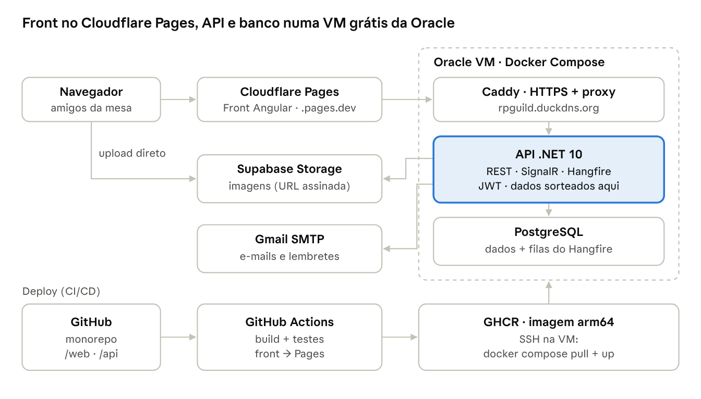

# RPGuild — Documento do projeto

Nov 23, 2026 · @Matheus oliveira

## Visão

O RPGuild é um site fechado para o grupo de RPG de mesa do Matheus que junta num lugar só o que hoje fica espalhado: agenda de sessões, campanhas, fichas e documentos. Ele é usado antes, durante e depois das sessões.

- **Problema:** sessões marcadas no WhatsApp/Discord, fichas em PDFs e sites diferentes, lore em Google Docs, rolagens sem histórico.

- **Para quem:** o grupo de amigos (uso fechado, não é plataforma pública).

- **Regra central de visibilidade:** o mestre vê tudo da campanha dele; cada jogador vê o que é seu e os documentos que os outros deixaram públicos.

- **Custo:** zero. Toda a infraestrutura roda em planos gratuitos.

- **Projeto anterior:** recomeço do RPGuild (antes React + Supabase), refeito do zero com React + .NET.

## Escopo e sistemas

A v1 entrega o produto completo (sem cortes) com um único sistema: **D&D 5e regras de 2024**, como o D&D Beyond usa por padrão. Não há prazo fixo.

| Sistema                                          | Quando | Observação                                          |
|--------------------------------------------------|--------|-----------------------------------------------------|
| D&D 2024 (+ conteúdo 2014 marcado como "Legacy") | v1     | Automação completa; referência de ficha: D&D Beyond |
| Ordem Paranormal 2                               | Depois | Ainda em playtest; referência: ficha do ERPG        |
| Tormenta 20                                      | Depois | Conteúdo protegido, cadastro manual                 |
| Call of Cthulhu                                  | Depois | Conteúdo protegido, cadastro manual                 |
| Deadlands                                        | Depois | Conteúdo protegido, cadastro manual                 |

**Conteúdo como dado:** classes, espécies, magias, itens etc. ficam no banco (system_content), carregados por seed a partir de JSON. A base é o SRD 5.2 (2024) e o SRD 5.1 (2014, Legacy), ambos sob CC-BY-4.0, com atribuição no site. O que estiver só no livro é adicionado ao JSON quando a mesa precisar. Não há tela de admin na v1.

**Fora da v1:** modalidade presencial/online de sessão (descartada por enquanto), tela de admin de conteúdo, diagramas UML.

## Requisitos

### Funcionais

- **Conta:** cadastro (nome, nick único, e-mail, senha), login, recuperação de senha por e-mail, perfil (nome, nick, foto, e-mail, senha).

- **Taberna:** amizades por e-mail ou nick; só amigos podem ser convidados para campanhas.

- **Campanhas:** quem cria é o mestre; sistema, nome, descrição, capa e banner; convites com aceite no card; configurações; saída e remoção de player.

- **Fichas:** várias por jogador; criação passo a passo; automação completa; tempo real; mestre cria fichas livres (NPCs).

- **Rolagens:** feitas pela ficha, sorteadas no servidor, histórico imutável; painel do mestre; rolagem livre do mestre.

- **Agenda:** calendário estilo Google Calendar; convite por sessão; resposta vou / não vou / talvez + motivo; aviso de conflito.

- **Documentos:** pastas aninhadas, editor de texto rico, privado ou público; anotações dentro da ficha.

- **Notificações:** sininho no menu e e-mail, conforme a matriz de notificações; lembretes 24h e 1h antes da sessão.

### Não funcionais

- Responsivo, pensado para celular (usado na mesa).

- Tempo real em fichas, rolagens e notificações (SignalR).

- Custo zero de hospedagem.

- Sistemas como módulos sobre um núcleo comum; conteúdo de regras no banco.

- Motor de regras só no front; o servidor confia no estado da ficha, mas sorteia os dados.

- Login com e-mail e senha (sem login social).

## Regras de negócio

### Campanha

- Quem cria a campanha é o mestre (owner_id); não existe campo separado de mestre.

- Só amigos podem ser convidados. Os convites da criação só disparam depois que a campanha é criada.

- O convite (e-mail ou link) leva ao card do convite; nada é aceito automaticamente. Só o usuário convidado e logado vê aceitar/recusar.

- Exclusão da campanha: digitar o nome da campanha e dar OK, depois digitar "desejo excluir a campanha" e dar OK.

### Fichas

- Fichas são sempre privadas: só o dono e o mestre acessam. Não há compartilhamento.

- O jogador pode ter várias fichas na campanha. O mestre cria fichas livres (sem tipo NPC).

- Edição simultânea: vale a última alteração de cada campo (PATCH parcial).

- Exclusão pelo dono ou pelo mestre, com dupla confirmação: nome da ficha + "desejo excluir a ficha".

### Documentos

- Cada usuário tem as próprias pastas (com subpastas) dentro da campanha.

- Documento privado ou público. Jogador vê os seus e os públicos dos outros (não as pastas deles). Mestre vê tudo.

- Anotações da ficha ficam na própria ficha e seguem a visibilidade dela.

### Rolagens

- Os dados são sorteados no servidor. O histórico é corrido (horário, ficha, rolagem, resultado) e não pode ser editado nem apagado.

- Jogador vê só as rolagens das próprias fichas; mestre vê todas no painel.

- Vantagem/desvantagem: seletor que vale para uma rolagem e volta sozinho para Normal.

### Agenda

- Só o mestre marca, edita e cancela sessões, escolhendo quais jogadores da campanha convidar.

- A sessão só aparece na agenda de quem foi convidado (e do mestre). O link funciona como o do convite de campanha.

- Resposta: vou / não vou / talvez, com motivo opcional.

- Lembretes 24h e 1h antes, só para quem respondeu vou ou talvez.

- Horários em conflito geram aviso. Sessão passada vira histórico.

### Taberna

- Solicitação de amizade por e-mail ou nick. Remover amigo pede confirmação; quem foi removido não recebe nada.

### Saída de player

- O player pede remoção com mensagem (aparece nas configurações do mestre), ou o mestre remove direto.

- Ao aprovar, o mestre decide, item a item: cada ficha vira dele (NPC) ou é excluída; os documentos são integrados (pasta "Documentos - ex player {nick}", privados) ou excluídos.

- Fechar o fluxo no meio = nada é salvo, o player continua e a solicitação fica pendente.

- Concluir = uma transação única: decisões aplicadas, membro removido, removido dos convites de sessões futuras, player notificado.

## Perfis e user stories

Quatro perfis: **Visitante** (não logado), **Usuário** (logado), **Mestre** (criou a campanha) e **Jogador** (convidado). Uma pessoa pode ser mestre numa campanha e jogador em outra.

| ID   | Área         | Story                                                                                            |
|------|--------------|--------------------------------------------------------------------------------------------------|
| US01 | Conta        | Como visitante, quero me cadastrar com nome, nick, e-mail e senha                                |
| US02 | Conta        | Como visitante, quero fazer login                                                                |
| US03 | Conta        | Como visitante, quero recuperar minha senha por e-mail                                           |
| US04 | Conta        | Como usuário, quero editar meu perfil (nome, nick, foto, e-mail, senha)                          |
| US05 | Taberna      | Como usuário, quero enviar, aceitar, recusar e cancelar solicitações de amizade e remover amigos |
| US06 | Campanha     | Como usuário, quero criar uma campanha escolhendo o sistema, tornando-me o mestre                |
| US07 | Campanha     | Como mestre, quero convidar amigos para a campanha                                               |
| US08 | Campanha     | Como usuário, quero abrir o convite (e-mail ou link), ver o card e aceitar ou recusar            |
| US09 | Campanha     | Como usuário, quero ver as campanhas em que participo                                            |
| US10 | Campanha     | Como mestre, quero editar ou excluir a campanha e remover jogadores                              |
| US11 | Campanha     | Como jogador, quero solicitar minha remoção com uma mensagem                                     |
| US12 | Fichas       | Como jogador, quero criar uma ou mais fichas no passo a passo                                    |
| US13 | Fichas       | Como jogador, quero editar minha ficha durante a sessão                                          |
| US14 | Fichas       | Como mestre, quero criar fichas livremente (NPCs, inimigos)                                      |
| US15 | Fichas       | Como mestre, quero ver e editar qualquer ficha em tempo real                                     |
| US16 | Rolagens     | Como jogador, quero rolar pela ficha e ver o histórico dela                                      |
| US17 | Rolagens     | Como mestre, quero ver todas as rolagens da campanha num painel                                  |
| US18 | Rolagens     | Como mestre, quero fazer rolagens livres sem ficha                                               |
| US19 | Agenda       | Como mestre, quero marcar, editar e cancelar sessões e escolher convidados                       |
| US20 | Agenda       | Como jogador, quero responder ao convite da sessão (vou, não vou, talvez + motivo)               |
| US21 | Agenda       | Como usuário, quero ver numa agenda as sessões para as quais fui convidado                       |
| US22 | Agenda       | Como usuário, quero ser avisado de conflito de horário                                           |
| US23 | Agenda       | Como jogador, quero receber lembretes 24h e 1h antes da sessão                                   |
| US24 | Documentos   | Como usuário, quero criar documentos e pastas, privados ou públicos                              |
| US25 | Documentos   | Como mestre, quero ver os documentos de todos os jogadores                                       |
| US26 | Notificações | Como usuário, quero ver minhas notificações no sininho                                           |

## Mapa de telas

O menu tem Home, Campanhas, Taberna e Agenda, mais o sininho e o avatar redondo (perfil) à direita. Home e Perfil abrem sem login; Campanhas, Taberna e Agenda mostram um empty state "necessário login".

- **Login, Cadastro, Esqueci / Redefinir senha** — telas públicas.

- **Home** (sem login) — menu, hero e seções institucionais (texto + imagem) para cada funcionalidade, cada uma com CTA. Logado, o CTA leva à aba; deslogado, leva ao login e depois redireciona para a aba escolhida.

- **Perfil** (avatar no menu) — edição de nome, nick, foto, e-mail e senha. Sem login: empty state "necessário cadastro".

- **Sininho** — lista de notificações com contador de não lidas.

- **Taberna** — título com botão "Enviar solicitação" (e-mail ou nick); abaixo, pendentes (recebidas e enviadas); abaixo, lista de amigos com "Remover" (confirmação + alert de sucesso).

- **Agenda** — calendário estilo Google Calendar com as sessões em que o usuário é mestre ou convidado. Mestre marca sessões e edita tudo; jogador edita só a própria resposta (vou / não vou / talvez + motivo). Convites de sessão aparecem aqui.

- **Campanhas** — selecionar uma campanha existente ou criar nova (sistema, nome, descrição, capa, banner, convidados com adicionar/remover antes de criar).

- **Card do convite** (/convites/{id}) — dados da campanha; aceitar/recusar só para o convidado logado.

- **Página da campanha**, de cima para baixo:

  1.  Hero com o banner e o nome da campanha sobreposto

  2.  Jogadores + "Convidar" (só mestre)

  3.  Visão geral / descrição

  4.  Próximas sessões (link para a agenda)

  5.  Fichas (mestre vê todas; jogador só as dele) + "Nova ficha"

  6.  Documentos: "Meus documentos" e, para o mestre, "Documentos dos players"; criar pasta ou documento em qualquer nível

  7.  Toggle Rolagens / Minhas rolagens (só mestre)

  8.  Configurações (só mestre): editar dados, players com remover, solicitações de saída, excluir campanha

  9.  Solicitar remoção (só jogador)

- **Ficha D&D** — detalhada na seção seguinte.

- **Editor de documento** — texto rico (TipTap), visibilidade, pasta.

## Ficha D&D 2024

A ficha segue o layout do D&D Beyond, com dois acréscimos: o painel de rolagens no canto e a aba Anotações. O motor de regras roda em TypeScript no front e recalcula tudo na hora.

**Criação (passo a passo):**

1.  Classe

2.  Antecedente (aumentos de atributo + talento de origem)

3.  Espécie

4.  Atributos (arranjo padrão, compra de pontos ou rolagem)

5.  Equipamento

6.  Magias, se a classe tiver

7.  Detalhes

Subir de nível segue o mesmo modelo: PV, características novas, subclasse no nível 3, talentos.

**Estrutura:**

- **Cabeçalho:** retrato, nome, espécie, classe, nível; descanso curto e longo (restauram recursos).

- **Faixa do topo:** 6 atributos (modificador + valor), bônus de proficiência, deslocamento, inspiração heroica, PV com Curar/Dano, atual/máximo e temporário.

- **Coluna esquerda:** salvaguardas, sentidos (percepção, investigação e intuição passivas, visão no escuro), proficiências e idiomas.

- **Coluna do meio:** 18 perícias (proficiência, atributo, bônus).

- **Coluna direita:** iniciativa, CA, defesas, condições e as abas:

  1.  Ações (filtros: todas, ataque, ação, ação bônus, reação, outras)

  2.  Magias (CD, ataque, espaços em checkbox, incluindo Pacto)

  3.  Inventário (carga, moedas, equipamento, mochila, bolsa de componentes, sintonia)

  4.  Características e traços (classe, espécie, talentos, contadores de uso)

  5.  Antecedente (características e aparência)

  6.  Notas (organizações, aliados, inimigos, história, outros)

  7.  Anotações (texto rico livre)

  8.  Extras (familiares, montarias, companheiros)

**Rolagens:**

- Tudo que tem bônus é clicável: atributos, salvaguardas, perícias, iniciativa, ataque, dano, magias.

- Seletor Normal / Vantagem / Desvantagem que vale para uma rolagem e volta para Normal.

- O front manda a fórmula; a API sorteia, grava e envia em tempo real ao mestre e ao dono da ficha.

- Dado 3D (dice-box) e um painel lateral recolhível no estilo do Game Log do Beyond: card com personagem, teste, dados, fórmula e total.

## Notificações

Cada ação tem um canal fixo: sininho (S), e-mail (E), os dois (SE) ou nada (N). Um serviço central na API decide o canal pelo tipo.

| \#  | Ação                                        | Quem recebe                          | Canal |
|-----|---------------------------------------------|--------------------------------------|-------|
| 1   | Cadastro concluído (boas-vindas)            | o próprio usuário                    | SE    |
| 2   | Pedido de redefinição de senha              | o próprio usuário                    | E     |
| 3   | Senha alterada                              | o próprio usuário                    | E     |
| 4   | E-mail alterado                             | o próprio usuário                    | E     |
| 5   | Recebeu solicitação de amizade              | destinatário                         | SE    |
| 6   | Solicitação de amizade aceita               | quem enviou                          | S     |
| 7   | Solicitação de amizade recusada             | quem enviou                          | S     |
| 8   | Removido da lista de amigos                 | ninguém (só alert para quem removeu) | N     |
| 9   | Recebeu convite de campanha                 | convidado                            | SE    |
| 10  | Convite de campanha aceito                  | mestre                               | S     |
| 11  | Convite de campanha recusado                | mestre                               | S     |
| 12  | Convite cancelado pelo mestre               | convidado                            | S     |
| 13  | Novo jogador entrou na campanha             | outros players                       | SE    |
| 14  | Player solicitou remoção                    | mestre                               | SE    |
| 15  | Solicitação de remoção aprovada ou recusada | player                               | SE    |
| 16  | Removido da campanha pelo mestre            | player                               | SE    |
| 17  | Campanha editada                            | players                              | S     |
| 18  | Campanha excluída                           | players                              | SE    |
| 19  | Convidado para uma sessão                   | convidado                            | SE    |
| 20  | Sessão alterada                             | convidados                           | SE    |
| 21  | Sessão cancelada                            | convidados                           | SE    |
| 22  | Removido de uma sessão                      | removido                             | SE    |
| 23  | Player respondeu à sessão                   | mestre                               | SE    |
| 24  | Lembrete 24h antes                          | quem respondeu vou/talvez            | E     |
| 25  | Lembrete 1h antes                           | quem respondeu vou/talvez            | E     |
| 26  | Conflito de horário entre sessões           | o próprio usuário                    | S     |
| 27  | Mestre editou sua ficha                     | dono da ficha                        | S     |
| 28  | Novo documento público                      | membros                              | S     |
| 29  | Documento público editado                   | membros                              | S     |
| 30  | Player fez uma rolagem                      | mestre (já vê no painel)             | N     |

## Modelo de dados

PostgreSQL com núcleo relacional; o que muda por sistema fica em JSONB (characters.dados, system_content.dados). Ser mestre = campaigns.owner_id. As tabelas do Identity e do Hangfire são criadas pelas bibliotecas.

| Tabela                  | Campos principais                                                                                                                                            | Observações                    |
|-------------------------|--------------------------------------------------------------------------------------------------------------------------------------------------------------|--------------------------------|
| users                   | id, nome, nick (único), email (único), senha_hash, avatar_path, created_at, updated_at                                                                       | ASP.NET Identity               |
| refresh_tokens          | id, user_id, token_hash, expires_at, revoked_at                                                                                                              | Refresh em cookie HttpOnly     |
| friendships             | id, requester_id, addressee_id, status (pendente, aceita, recusada), created_at, responded_at                                                                | Remover amigo apaga a linha    |
| game_systems            | id, slug (dnd2024, ordem2, t20, coc, deadlands), nome, ativo                                                                                                 | Só dnd2024 ativo na v1         |
| system_content          | id, system_id, tipo (classe, subclasse, especie, antecedente, talento, magia, item…), slug, nome, origem (2024, legacy), dados JSONB, versao                 | Preenchida pelo seed           |
| campaigns               | id, owner_id, system_id, nome, descricao, capa_path, banner_path, created_at, updated_at                                                                     | owner = mestre                 |
| campaign_members        | campaign_id, user_id, joined_at                                                                                                                              | Só jogadores; PK composta      |
| campaign_invites        | id, campaign_id, invited_by, user_id, status (pendente, aceito, recusado, cancelado), created_at, responded_at                                               | Só amigos                      |
| campaign_leave_requests | id, campaign_id, user_id, mensagem, status (pendente, aprovada, recusada), created_at, responded_at                                                          |                                |
| characters              | id, campaign_id, owner_id, nome, retrato_path, dados JSONB, anotacoes JSONB, created_at, updated_at                                                          | Sempre privada (dono + mestre) |
| dice_rolls              | id, campaign_id, user_id, character_id (null = rolagem livre), descricao, formula, modo (normal, vantagem, desvantagem), resultados JSONB, total, created_at | Imutável                       |
| game_sessions           | id, campaign_id, titulo, descricao, inicio (timestamptz), duracao_min, status (agendada, cancelada), created_at, updated_at                                  |                                |
| session_invites         | session_id, user_id, status (pendente, vou, nao_vou, talvez), motivo, invited_at, responded_at                                                               | PK composta                    |
| session_reminders       | id, session_id, tipo (24h, 1h), job_id, enviar_em, enviado_em                                                                                                | Evita envio duplicado          |
| folders                 | id, campaign_id, owner_id, parent_id (null = raiz), nome, created_at                                                                                         | Pastas por usuário             |
| documents               | id, campaign_id, owner_id, folder_id, titulo, conteudo JSONB, visibilidade (privada, publica), created_at, updated_at                                        |                                |
| notifications           | id, user_id, tipo, dados JSONB, lida_em, created_at                                                                                                          | Sininho                        |

**Mudanças desde a primeira versão:** entrou nick e amizades; convite de campanha passou a ser por usuário (sem token de link); session_attendance virou session_invites com motivo; capa e banner separados; fichas sem visibilidade e com anotações; pastas, saídas e notificações adicionadas; conteúdo ganhou origem 2024/Legacy.

## Arquitetura e stack

Tudo roda em planos gratuitos: o front no Cloudflare Pages e API, banco e jobs numa VM Always Free da Oracle, atrás do Caddy com HTTPS.



arquitetura e deploy · custo zero

O front fala com a API por REST e WebSocket (SignalR). As imagens sobem direto do navegador para o Supabase Storage com uma URL assinada pela API.

| Camada       | Escolha                                                                                                |
|--------------|--------------------------------------------------------------------------------------------------------|
| Front        | React + Vite + TypeScript, Tailwind + shadcn/ui, React Bits, TipTap, dice-box, FullCalendar; motor de regras D&D em TypeScript |
| Back         | ASP.NET Core Web API (.NET 10), monólito modular em camadas (Api, Application, Domain, Infrastructure) |
| Banco        | PostgreSQL + EF Core                                                                                   |
| Autenticação | ASP.NET Identity, JWT curto + refresh token em cookie HttpOnly                                         |
| Tempo real   | SignalR: CampaignHub (grupo por campanha) e NotificationHub (por usuário)                              |
| Agendamento  | Hangfire (lembretes 24h e 1h)                                                                          |
| E-mail       | Gmail SMTP com senha de app (MailKit)                                                                  |
| Imagens      | Supabase Storage (plano grátis)                                                                        |
| Hospedagem   | Oracle Cloud Always Free (VM ARM, Docker Compose) + Cloudflare Pages                                   |
| Domínios     | rpguild.pages.dev (front) e rpguild.duckdns.org (API)                                                  |
| CI/CD        | GitHub Actions: build e testes em PR; front no Pages; API em imagem arm64 no GHCR com deploy por SSH   |
| Repositório  | Monorepo /web, /api, /docs                                                                             |

**Decisões e trade-offs:**

- O motor de regras fica só no front. O servidor confia no estado da ficha, mas sorteia os dados, então o resultado do dado é sempre honesto.

- O DuckDNS substitui um domínio pago: o HTTPS exige um nome, e um .dev próprio custaria cerca de US\$ 12 por ano.

- A VM da Oracle é ARM64, então as imagens Docker são buildadas para arm64.

## Endpoints da API

Prefixo /api, JWT no header, JSON, erros em ProblemDetails, listas paginadas por cursor, Swagger em /swagger. Autorização por policies (mestre, membro, dono).

**Auth**

```
POST /auth/register {nome, nick, email, senha}
POST /auth/login → access token + refresh (cookie HttpOnly)
POST /auth/refresh
POST /auth/logout
POST /auth/forgot-password {email}
POST /auth/reset-password {token, novaSenha}
```

**Perfil e uploads**

```
GET /me
PUT /me {nome, nick, avatarPath}
PUT /me/email {novoEmail, senha}
POST /me/email/confirm {token}
PUT /me/password {atual, nova}
POST /uploads/sign {tipo, contentType} → {uploadUrl, path, publicUrl}
```

**Taberna**

```
GET /friends → [{userId, nome, nick, avatarUrl, campanhasEmComum, amigosDesde}]
GET /friends/requests (recebidas + enviadas) → {recebidos: [{id, de: {userId, nome, nick, avatarUrl}, criadoEm}], enviados: [{id, para: {userId, nome, nick, avatarUrl}, criadoEm}]}
POST /friends/requests {emailOuNick}
POST /friends/requests/{id}/accept
POST /friends/requests/{id}/decline
DELETE /friends/requests/{id} (cancelar enviada)
DELETE /friends/{userId}
```

As listas de amigos e de pedidos não são paginadas.

**Campanhas e convites**

```
GET /campaigns (onde sou mestre ou jogador)
POST /campaigns {nome, descricao, capaPath, bannerPath, sistema, convidados\[\]}
GET /campaigns/{id}
PUT /campaigns/{id}
DELETE /campaigns/{id} {confirmacaoNome, confirmacaoFrase}
GET /campaigns/{id}/members
POST /campaigns/{id}/invites {userIds\[\]} (só amigos)
GET /campaign-invites/{id} (card; flag podeResponder)
POST /campaign-invites/{id}/accept
POST /campaign-invites/{id}/decline
DELETE /campaign-invites/{id} (mestre cancela)
```

**Saída de player**

```
POST /campaigns/{id}/leave-requests {mensagem}
GET /campaigns/{id}/leave-requests (mestre)
POST /campaigns/{id}/leave-requests/{rid}/decline
GET /campaigns/{id}/members/{userId}/removal-preview
POST /campaigns/{id}/members/{userId}/removal {leaveRequestId?, fichas:\[{id, acao}\], docs: integrar|excluir}
```

**Fichas e conteúdo**

```
GET /campaigns/{id}/characters (mestre: todas · jogador: as dele)
POST /campaigns/{id}/characters
GET /characters/{id}
PATCH /characters/{id} (só campos alterados)
DELETE /characters/{id} {confirmacaoNome, confirmacaoFrase}
GET /systems/{slug}/content?tipo=…
GET /systems/{slug}/content/{tipo}/{slug}
```

**Rolagens**

```
POST /campaigns/{id}/rolls {characterId?, descricao, formula, modo}
GET /characters/{id}/rolls
GET /campaigns/{id}/rolls (mestre)
```

**Sessões e agenda**

```
GET /sessions?from=&to=
GET /campaigns/{id}/sessions?upcoming=true
POST /campaigns/{id}/sessions {titulo, descricao, inicio, duracaoMin, convidados\[\]}
GET /sessions/{id}
PUT /sessions/{id}
PUT /sessions/{id}/invitees {userIds\[\]}
POST /sessions/{id}/cancel
PATCH /sessions/{id}/invite {status, motivo?}
```

**Documentos**

```
GET /campaigns/{id}/documents/tree
POST /campaigns/{id}/folders {nome, parentId?}
PUT /folders/{id} {nome, parentId?}
DELETE /folders/{id}
POST /campaigns/{id}/documents {titulo, folderId?}
GET /documents/{id}
PUT /documents/{id} {titulo, conteudo, visibilidade, folderId?}
DELETE /documents/{id}
```

**Notificações**

```
GET /notifications
GET /notifications/unread-count
POST /notifications/{id}/read
POST /notifications/read-all
```

**Tempo real (SignalR)**

```
/hubs/campaign JoinCampaign(id) · CharacterUpdated · RollCreated · MemberChanged · SessionChanged · DocumentChanged
/hubs/notifications NotificationCreated · UnreadCount
```

## Backlog e sprints

O backlog está no Trello, no quadro [RPGuild](https://trello.com/b/qBRH7HXp/rpguild): 74 cards em 11 sprints, em ordem de dependência. Fluxo: puxar o card da lista da sprint para **Fazendo** e depois para **Feito**.

| Sprint                      | Entrega                                                                                    |
|-----------------------------|--------------------------------------------------------------------------------------------|
| S0 · Setup e infra          | Monorepo, solution .NET, React, CI, VM Oracle, DuckDNS + Caddy, deploy da API e do front |
| S1 · Contas e perfil        | Identity + JWT, e-mail SMTP, recuperação de senha, upload, perfil, home, empty states      |
| S2 · Taberna e notificações | Amizades, serviço de notificações, NotificationHub e sininho                               |
| S3 · Campanhas              | CRUD, convites, card do convite, página da campanha, configurações, CampaignHub            |
| S4 · Conteúdo D&D           | SRD 2024 e Legacy em JSON, system_content, seed, endpoints de conteúdo                     |
| S5 · Ficha D&D              | Motor de regras, criação, layout Beyond, abas, descansos, subir de nível, tempo real       |
| S6 · Rolagens               | RNG no servidor, dado 3D, painel, vantagem/desvantagem, painel do mestre                   |
| S7 · Agenda e sessões       | Sessões, Hangfire (lembretes), FullCalendar, convites de sessão, conflito                  |
| S8 · Documentos             | Pastas, TipTap, visibilidade, árvore do mestre                                             |
| S9 · Saída de player        | Solicitação, preview, fluxo do mestre, transação única                                     |
| S10 · Polimento             | Mobile, testes de integração, backup, rate limit, README                                   |

**Próximo passo:** começar a S0 pelo card "Criar monorepo".
